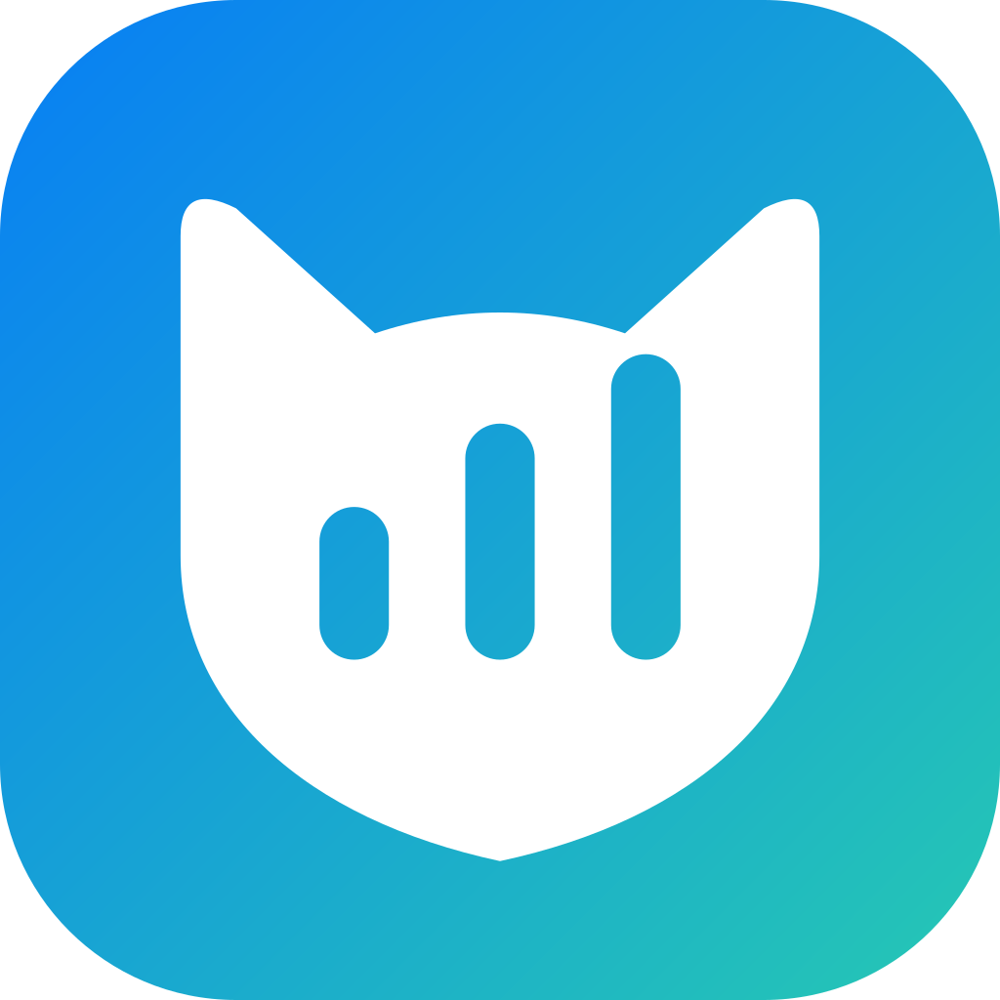

<div align="center">



# Lee’s Clash

基于 CMFA / mihomo 的 Android 代理客户端，采用 Kotlin / Compose 与 Lucid 风格界面。

[下载发行版](https://github.com/lyq2010/lees-clash/releases/tag/v0.0.1) · [更新日志](CHANGELOG.md) · [开发维护](docs/HANDOFF.md) · [开发矩阵](docs/DEVELOPMENT-MATRIX.md)

</div>

## 当前版本与能力

源码版本 **0.0.1**，目前完成本地验包，发布按用户要求暂缓；以下下载链接在发行后可用。支持配置链接、文件和二维码导入，配置编辑与更新，策略组选择和测速，以及停止代理后的策略与规则浏览。首页可查看订阅用量与到期并直接更新，网络页提供手动 IP 检查、按需网络与局域网共享。

提供连接、规则、DNS、流量和日志诊断，内存详情与手动清理 DNS 缓存，完整覆写编辑、五类 Geo 数据管理、两类 age 加密配置、本地备份恢复、自定义规则与受限配置脚本。按需网络默认关闭；WebDAV 不在当前范围。

原签名 Release 已完成四架构构建及 ARM64 Android 15 / 17 运行验证，覆盖 VPN、本地实际代理转发和相机扫码。物理 Wi-Fi / 蜂窝切换、厂商后台限制及真实订阅仍需实际设备验收，具体边界见[开发矩阵](docs/DEVELOPMENT-MATRIX.md)。

## 安装与更新

最低 Android 8.0 / API 26。提供 `arm64-v8a`、`armeabi-v7a`、`x86`、`x86_64` 和通用 APK；按设备架构选择，无法确认时使用通用包。ARM64 安装包约 **46 MiB**，通用包约 **120 MiB**，全部功能与 Geo 数据保留。

[ARM64 下载](https://releases.angelolee.cn/lees-clash-0.0.1-arm64-v8a.apk) · [通用包下载](https://releases.angelolee.cn/lees-clash-0.0.1.apk) · [备用通用包](https://plt-releases.leenbsl.workers.dev/lees-clash-0.0.1.apk)

安装时按系统提示允许安装来源，首次启用代理需授予 VPN 权限。应用使用独立签名，升级须使用同一签名的安装包。应用内手动检查更新，下载后校验大小、SHA-256、包名、版本和签名。

Release 原生库在安装时解压，以减少 APK 下载体积；ARM64 的 APK 加原生库占用会比未压缩打包增加约23 MiB，实测范围见[发布文档](docs/RELEASE.md#安装包体积)。本地备份包含订阅链接和密钥，保存和传递时请按敏感文件处理。

## 本地开发与验证

私有源码仓为 `lyq2010/lees-clash`，`main` 为维护分支。应用使用 Kotlin / Jetpack Compose、Android 服务与 Go 内核，固定 mihomo、Geo 和工具版本，不在构建时追踪浮动分支。

Mac 工具链位于外挂卷，构建入口仅设置当前命令环境，共享缓存和临时文件写入 `/Volumes/DISK/DevCache/lees-clash`：

```bash
bash scripts/Build.sh
bash scripts/Build.sh :app:testAlphaDebugUnitTest
GOMAXPROCS=4 bash scripts/Build.sh :app:assembleAlphaRelease --max-workers=4
```

Windows 使用 `pwsh -File scripts/Build.ps1`。签名准备、完整依赖、专用模拟器及测试入口见[构建与发布](docs/RELEASE.md)。真实机场订阅不用于自动回归；本地测试仅使用回环合成配置。

## 发行与维护

源码和 GitHub Release 使用当前私有仓；COS 为主下载镜像，R2 为备用镜像。Actions 仅手动触发，固定版本标签后执行构建、签名、R8 运行和产物校验，再上传并校验镜像。发行流程见[构建与发布](docs/RELEASE.md)，后续工作与清理记录见[交接文档](docs/HANDOFF.md)。

[界面与品牌规范](docs/UI-DESIGN.md) · [来源与固定版本](docs/UPSTREAM.md) · [隐私政策](PRIVACY_POLICY.md)

基于 [CMFA](https://github.com/MetaCubeX/ClashMetaForAndroid) 修改，使用 [mihomo](https://github.com/MetaCubeX/mihomo) 内核。保留 [GPL-3.0](LICENSE)、[第三方声明](NOTICE)和原有版权声明，独立维护不代表从零开发。
